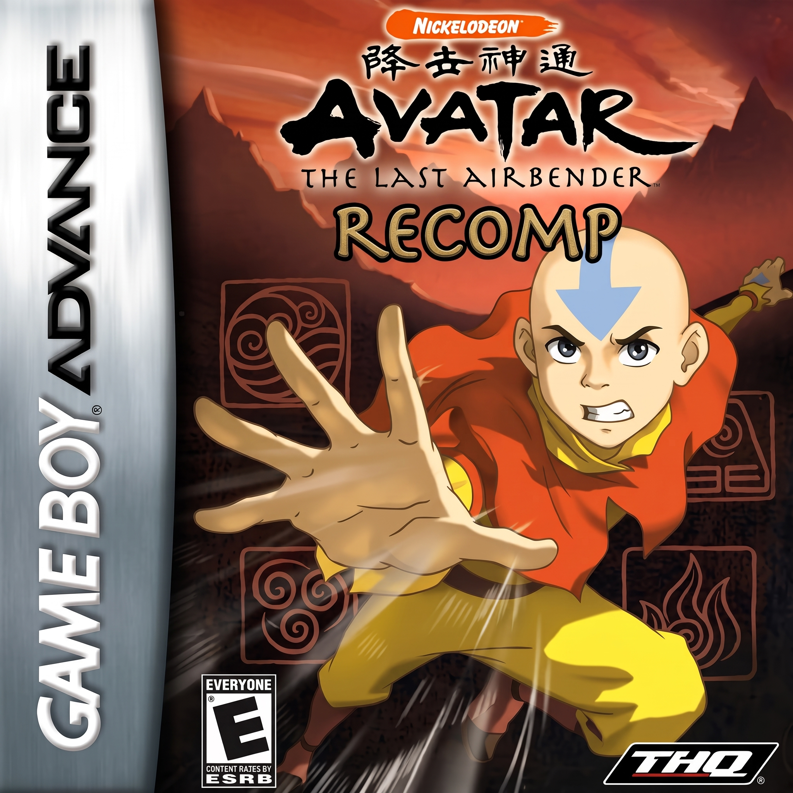

<div align="center">



# Avatar: The Last Airbender — Recomp

**O clássico do Game Boy Advance rodando nativo no PC.**
Cada função ARM/Thumb da ROM vira C++ e roda sobre uma reimplementação do hardware do GBA.


[Sobre](#-sobre) · [Destaques](#-destaques) · [Como jogar](#-como-jogar) · [Controles](#-controles) ·
[Como funciona](#-como-funciona) · [Roadmap](#-roadmap) · [Desenvolvimento](#-desenvolvimento)

</div>

> [!IMPORTANT]
> Este repositório **não contém a ROM nem assets do jogo**. Você precisa do seu próprio dump do
> cartucho americano (`BQZE`).

## 🌀 Sobre

*Avatar: The Last Airbender* (THQ, 2006) para GBA, recompilado estaticamente para PC. Não é um
emulador comum. O recompilador `tlarecomp` analisa a ROM, encontra **3 640 funções** e gera uma
função C++ para cada uma. O resultado é compilado junto com um runtime que reimplementa o
hardware do GBA: vídeo, som, DMA, timers, interrupções e save.

O jogo roda do começo ao fim pelo código recompilado. Em 7 000 quadros, só **2 instruções**
passam pelo interpretador de reserva, e os testes diferenciais contra o interpretador dão
**0 divergências**.

## ✨ Destaques

| | |
|---|---|
| ⚡ **Rápido** | ~56× a velocidade do GBA sem limite (o código recompilado sozinho roda a ~216×) |
| 🎮 **Controle de verdade** | XInput (Xbox, 8BitDo em modo X…), com analógico, gatilhos e botão home |
| 🛠️ **Tela de configurações** | No visual do próprio jogo. A partida fica congelada enquanto ela está aberta |
| 💾 **Save states** | 10 slots, carregamento transacional (um estado ruim nunca corrompe a partida) |
| 🖥️ **Feito para PC** | Tela cheia sem borda, pixels nítidos com proporção correta, turbo, pausa, capturas PNG |
| 🔊 **Som fiel** | FIFOs + 4 canais PSG a 48 kHz via XAudio2. O áudio é o relógio, então são 60 fps estáveis |
| 🧪 **Verificado** | Testes diferenciais, fuzzer de instruções, teste de mutação e quadros de referência |

<div align="center">
  <br>
  <sub>A tela de configurações, desenhada com a paleta das caixas de diálogo do jogo.</sub>
</div>

## 🎮 Como jogar

### Requisitos

- Windows 10/11 com **Visual Studio 2022 Build Tools** (C++, CMake, Ninja)
- **Python 3.10+**
- Sua ROM: `BQZE`, SHA-1 `9d864e9b3ccce4e5e1b1c566afa0d06088e88dfd`, na pasta `roms/`

### Compilar

```powershell
.\scripts\build.ps1                                                # 1) ferramentas e runtime
.\build\release\tlarecomp.exe emit "roms\<sua-rom>.gba"            # 2) gera generated\recomp\
.\scripts\build.ps1                                                # 3) compila o código gerado (~1 min)
```

> [!TIP]
> Sem o passo 2, o `tlagba` roda só com o interpretador (cerca de 3× mais lento). Para compilar
> com o jogo aberto, use outra pasta: `.\scripts\build.ps1 -BuildDir build\dev`.

### Jogar

```powershell
.\build\release\tlagba.exe "roms\<sua-rom>.gba"
```

O save do jogo (EEPROM) fica em `roms\<sua-rom>.sav`.

## 🕹️ Controles

| GBA | Teclado | Controle |
|-----|---------|----------|
| Direcional | Setas | Direcional ou analógico esquerdo |
| A / B | X / Z | A / B (e X) |
| L / R | A / S | LB, LT / RB, RT |
| Start / Select | Enter / Backspace | Start / Back |

Tudo pode ser remapeado na tela de configurações.

### Tela de configurações

Abre com **Esc**, **F1**, o botão **Xbox/home** do controle ou **Back+Start**. O jogo congela
enquanto ela está aberta. Nela você encontra:

- continuar, salvar e carregar estado (10 slots), sair do jogo;
- tela cheia, tamanho da janela (1×–8×), volume;
- analógico como direcional;
- remapear teclado e controle (escolha o botão e aperte a nova tecla);
- restaurar padrões.

As escolhas são gravadas em `tlagba.ini`, ao lado do executável. O arquivo é comentado e também
pode ser editado à mão.

### Atalhos

| Tecla | Ação |
|-------|------|
| F5 / F9 | salvar / carregar estado (`roms\states\`) |
| F6 / F7 | slot anterior / próximo |
| Tab (segurar) | turbo |
| P | pausa |
| F11 ou Alt+Enter | tela cheia |
| F12 | captura PNG (`roms\screenshots\`) |

<details>
<summary><b>Opções de linha de comando</b></summary>

| Opção | Efeito |
|-------|--------|
| `--interp` | ignora o código recompilado |
| `--mute` | sem áudio (ritmo pelo relógio) |
| `--scale N` | tamanho da janela (sobrepõe o ini) |
| `--load-state f` | começa a partir de um save state |
| `--headless --frames N` | sem janela, para testes |
| `--shot f.png` / `--shot-every K prefixo` | capturas PNG |
| `--press TECLA@ini-fim` | roteiro de botões |
| `--wav f.wav` | grava o áudio |
| `--save-state-at N f` / `--load-state-at N f` | grava / carrega um estado no quadro N (headless, testes) |
| `--fallback-log f.txt` | endereços executados pelo interpretador |
| `--profile` / `--no-render` | tempo por subsistema / pula a renderização (diagnóstico) |

</details>

## 🔧 Como funciona

```
            ┌──────────────┐  análise + tradução  ┌────────────────────┐
 ROM (.gba) │  tlarecomp   │ ───────────────────▶ │ generated/recomp/  │
 ─────────▶ │  (C++20)     │                      │ 1 função C++ por   │
            └──────────────┘                      │ função ARM/Thumb   │
                   ▲ config/functions.txt          └─────────┬──────────┘
                                                             │ compila junto
            ┌────────────────────────────────────────────────▼─────────┐
            │ runtime (C++20)                                          │
            │  CPU · memória · PPU · APU · DMA · timers · IRQ · EEPROM │
            │  BIOS HLE · agendador por eventos · interpretador        │
            └───────────────────────────┬──────────────────────────────┘
                                        │
                  tlagba (janela Win32 + XAudio2 / headless)  ·  tlaverify
```

- **Recompilador:** decodifica ARM e Thumb numa IR comum, descobre funções por `BL`, ponteiros
  e tabelas de switch, e emite C++ com os ciclos contados por bloco.
- **Execução híbrida:** o código recompilado e o interpretador se alternam a qualquer momento.
  Overlays copiados para a IWRAM (mixer de som, handler de IRQ) e saltos inesperados caem no
  interpretador sem perder o estado.
- **PPU:** modos 0–5, sprites afins, janelas e blending, com composição e efeitos de cor em
  SSE2.

Mais detalhes em [ARCHITECTURE.md](docs/ARCHITECTURE.md), [TESTING.md](docs/TESTING.md),
[PERFORMANCE.md](docs/PERFORMANCE.md) e [PAK_FORMAT.md](docs/PAK_FORMAT.md).

## 🗺️ Roadmap

| Fase | | |
|------|---|---|
| 0 — Fundação | ✅ | estrutura, validação da ROM, build |
| 1 — Entender o código | ✅ | decodificador, descoberta de funções, extrator de assets |
| 2 — Runtime + interpretador | ✅ | hardware completo, jogo jogável interpretado, áudio |
| 3 — Recompilação | ✅ | jogo inteiro recompilado, verificação, desempenho |
| 4 — Melhorias de PC | 🚧 | ✅ save states, controle, tela de configurações · ⏳ widescreen, mods |

Lista completa em [docs/ROADMAP.md](docs/ROADMAP.md).

## 🧑‍💻 Desenvolvimento

<details>
<summary><b>Ferramentas e testes</b></summary>

```powershell
.\build\release\test_decoder.exe                                    # decodificador ARM/Thumb
.\build\release\test_ppu.exe                                        # PPU contra a referência
.\build\release\test_state.exe "roms\<sua-rom>.gba"                 # save states
.\build\release\tlarecomp.exe analyze "roms\<sua-rom>.gba" --disasm # relatórios + disassembly
.\build\release\tlarecomp.exe dis "roms\<sua-rom>.gba" 0x08097C30 56 arm --at 0x03000000
```

Equivalência recompilado × interpretador (detalhes em [TESTING.md](docs/TESTING.md)):

```powershell
.\build\release\tlaverify.exe "roms\<sua-rom>.gba" --frames 3000 --fuzz 5 --press START@900-905
.\scripts\test_synth.ps1        # fuzzer de instruções (ROM sintética)
.\scripts\mutation_test.ps1     # os testes ainda pegam bugs conhecidos?
.\scripts\bench.ps1             # desempenho
```

</details>

<details>
<summary><b>Assets do jogo</b></summary>

Os dados ficam num pacote HBPak dentro da ROM ([formato](docs/PAK_FORMAT.md)):

```powershell
python tools\pak.py verify  "roms\<sua-rom>.gba"   # confere a ida e volta byte a byte
python tools\pak.py extract "roms\<sua-rom>.gba"   # -> assets\extracted\ (fora do Git)
python tools\pak.py build   assets\extracted build\data.pak
```

</details>

Os commits seguem [Conventional Commits](https://www.conventionalcommits.org/), em português.

## ⚖️ Licença

Código sob **GPL-3.0** (veja [LICENSE](LICENSE)).

*Avatar: The Last Airbender* e seus personagens são marcas da Nickelodeon/Viacom; o jogo é da
THQ. Este é um projeto de fãs, sem fins lucrativos e sem afiliação com os detentores dos
direitos. Nenhum código ou dado do jogo original é distribuído aqui.
