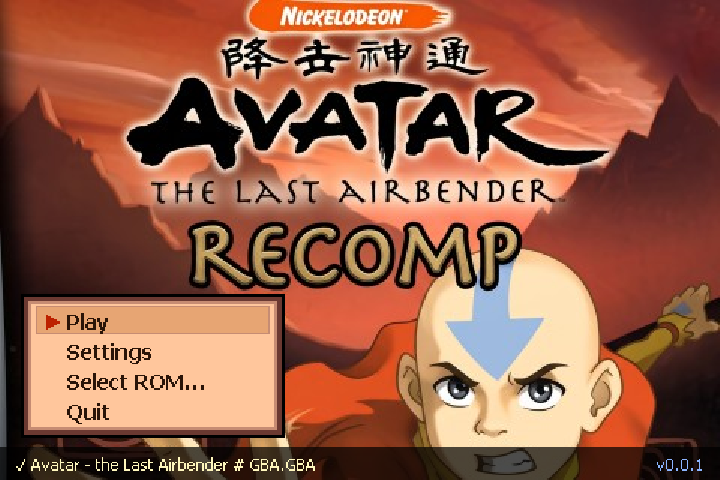
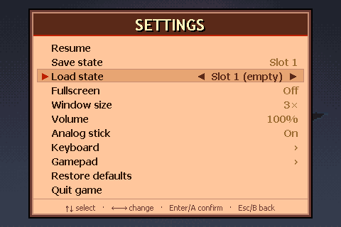

<div align="center">


# Avatar: The Last Airbender — Recomp

**The Game Boy Advance classic, running natively on PC.**
Every ARM/Thumb function in the ROM becomes C++ and runs on top of a reimplementation of the GBA hardware.


[](https://github.com/PedroVitor-Dev/The_Last_Airbender_Recomp/releases/latest)

[About](#-about) · [Highlights](#-highlights) · [How to play](#-how-to-play) · [Controls](#-controls) ·
[How it works](#-how-it-works) · [Roadmap](#-roadmap) · [Development](#-development) · [Support](#-support)

</div>

> [!IMPORTANT]
> This repository **does not contain the ROM or any game assets**. You need your own dump of the
> US cartridge (`BQZE`).

## 🌀 About

*Avatar: The Last Airbender* (THQ, 2006) for the GBA, statically recompiled for PC. This is not a
regular emulator. The `tlarecomp` recompiler analyzes the ROM, finds **3,640 functions** and
generates one C++ function for each of them. The result is compiled together with a runtime that
reimplements the GBA hardware: video, sound, DMA, timers, interrupts and saves.

The game runs from start to finish through the recompiled code. Over 7,000 frames, only
**2 instructions** go through the fallback interpreter, and differential tests against the
interpreter show **0 divergences**.

## ✨ Highlights

| | |
|---|---|
| ⚡ **Fast** | ~56× GBA speed when unthrottled (the recompiled code alone runs at ~216×) |
| 🎮 **Real gamepad support** | XInput (Xbox, 8BitDo in X mode…), with analog stick, triggers and the home button |
| 🚀 **Launcher** | Title screen with the cover art: play, settings and ROM selection, with the ROM verified |
| 🛠️ **Settings screen** | Styled after the game itself. The game freezes while it is open |
| 💾 **Save states** | 10 slots, transactional loading (a bad state never corrupts your game) |
| 🖥️ **Made for PC** | Borderless fullscreen, crisp pixels at the correct aspect ratio, turbo, pause, PNG screenshots |
| 🔊 **Faithful sound** | FIFOs + 4 PSG channels at 48 kHz via XAudio2. Audio drives the clock, so 60 fps stays steady |
| 🧪 **Verified** | Differential tests, an instruction fuzzer, mutation testing and reference frames |

<div align="center">
  
  <br>
  <sub>The launcher and the settings screen, drawn with the palette of the game's dialog boxes.</sub>
</div>

## 🎮 How to play

### Download (Windows 10/11, 64-bit)

1. Download `AvatarRecomp-vX.Y.Z-win64.zip` from the
   [latest release](https://github.com/PedroVitor-Dev/The_Last_Airbender_Recomp/releases/latest)
   and extract it.
2. Put your ROM (`.gba`, USA version `BQZE`) in the `roms` folder.
3. Run `AvatarRecomp.exe` and choose **Play** in the launcher.

The launcher finds the ROM by itself and checks that it is the right one. You can also drag the
ROM onto the executable, or use **Select ROM…**; the choice is remembered. To skip the launcher,
turn off **Launcher at startup** in the settings. Windows may show a SmartScreen warning because the program is not signed: click
**More info** → **Run anyway**. No installer and no extra runtimes needed.

### Build from source

Requirements:

- Windows 10/11 with **Visual Studio 2022 Build Tools** (C++, CMake, Ninja)
- **Python 3.10+**
- Your ROM: `BQZE`, SHA-1 `9d864e9b3ccce4e5e1b1c566afa0d06088e88dfd`, in the `roms/` folder

### Build

```powershell
.\scripts\build.ps1                                                # 1) tools and runtime
.\build\release\tlarecomp.exe emit "roms\<your-rom>.gba"           # 2) generates generated\recomp\
.\scripts\build.ps1                                                # 3) compiles the generated code (~1 min)
```

> [!TIP]
> Without step 2, `tlagba` runs on the interpreter only (about 3× slower). To build while the game
> is running, use another folder: `.\scripts\build.ps1 -BuildDir build\dev`.

### Run your build

```powershell
.\build\release\AvatarRecomp.exe                     # same as the release: finds the ROM by itself
.\build\release\tlagba.exe "roms\<your-rom>.gba"     # console version, with the options below
```

To build the release zip: `.\scripts\package.ps1` (output in `dist\`).

The in-game save (EEPROM) is stored in `roms\<your-rom>.sav`.

## 🕹️ Controls

| GBA | Keyboard | Gamepad |
|-----|----------|---------|
| D-pad | Arrow keys | D-pad or left stick |
| A / B | X / Z | A / B (and X) |
| L / R | A / S | LB, LT / RB, RT |
| Start / Select | Enter / Backspace | Start / Back |

Everything can be remapped in the settings screen.

### Settings screen

Open it with **Esc**, **F1**, the gamepad's **Xbox/home** button or **Back+Start**. The game
freezes while it is open. In it you can:

- resume, save and load states (10 slots), quit the game;
- toggle fullscreen, change the window size (1×–8×) and the volume;
- use the analog stick as a D-pad;
- remap the keyboard and the gamepad (pick a button, then press the new key);
- restore the defaults.

Your choices are saved to `tlagba.ini`, next to the executable. The file is commented and can
also be edited by hand.

### Shortcuts

| Key | Action |
|-----|--------|
| F5 / F9 | save / load state (`roms\states\`) |
| F6 / F7 | previous / next slot |
| Tab (hold) | turbo |
| P | pause |
| F11 or Alt+Enter | fullscreen |
| F12 | PNG screenshot (`roms\screenshots\`) |

<details>
<summary><b>Command-line options</b></summary>

| Option | Effect |
|--------|--------|
| `--interp` | ignore the recompiled code |
| `--mute` | no audio (paced by the system clock) |
| `--scale N` | window size (overrides the ini) |
| `--load-state f` | start from a save state |
| `--headless --frames N` | no window, for tests |
| `--shot f.png` / `--shot-every K prefix` | PNG screenshots |
| `--press KEY@start-end` | scripted button presses |
| `--wav f.wav` | record the audio |
| `--save-state-at N f` / `--load-state-at N f` | save / load a state at frame N (headless, tests) |
| `--fallback-log f.txt` | addresses executed by the interpreter |
| `--profile` / `--no-render` | time per subsystem / skip rendering (diagnostics) |

</details>

## 🔧 How it works

```
            ┌──────────────┐  analysis + translation  ┌────────────────────┐
 ROM (.gba) │  tlarecomp   │ ───────────────────────▶ │ generated/recomp/  │
 ─────────▶ │  (C++20)     │                          │ 1 C++ function per │
            └──────────────┘                          │ ARM/Thumb function │
                   ▲ config/functions.txt             └─────────┬──────────┘
                                                                │ compiled together
            ┌───────────────────────────────────────────────────▼──────┐
            │ runtime (C++20)                                          │
            │  CPU · memory · PPU · APU · DMA · timers · IRQ · EEPROM  │
            │  BIOS HLE · event scheduler · interpreter                │
            └───────────────────────────┬──────────────────────────────┘
                                        │
                  tlagba (Win32 window + XAudio2 / headless)  ·  tlaverify
```

- **Recompiler:** decodes ARM and Thumb into a shared IR, discovers functions through `BL` calls,
  pointers and switch tables, and emits C++ with cycles counted per block.
- **Hybrid execution:** recompiled code and the interpreter can hand off to each other at any
  point. Overlays copied into IWRAM (sound mixer, IRQ handler) and unexpected jumps fall back to
  the interpreter without losing state.
- **PPU:** modes 0–5, affine sprites, windows and blending, with SSE2 compositing and color
  effects.

More details (in Portuguese) in [ARCHITECTURE.md](docs/ARCHITECTURE.md),
[TESTING.md](docs/TESTING.md), [PERFORMANCE.md](docs/PERFORMANCE.md) and
[PAK_FORMAT.md](docs/PAK_FORMAT.md).

## 🗺️ Roadmap

| Phase | | |
|-------|---|---|
| 0 — Foundation | ✅ | repository layout, ROM validation, build |
| 1 — Understanding the code | ✅ | decoder, function discovery, asset extractor |
| 2 — Runtime + interpreter | ✅ | full hardware, game playable through the interpreter, audio |
| 3 — Recompilation | ✅ | whole game recompiled, verification, performance |
| 4 — PC enhancements | 🚧 | ✅ save states, gamepad, settings screen · ⏳ widescreen, mods |

Full list in [docs/ROADMAP.md](docs/ROADMAP.md).

## 🧑‍💻 Development

<details>
<summary><b>Tools and tests</b></summary>

```powershell
.\build\release\test_decoder.exe                                     # ARM/Thumb decoder
.\build\release\test_ppu.exe                                         # PPU against the reference
.\build\release\test_state.exe "roms\<your-rom>.gba"                 # save states
.\build\release\tlarecomp.exe analyze "roms\<your-rom>.gba" --disasm # reports + disassembly
.\build\release\tlarecomp.exe dis "roms\<your-rom>.gba" 0x08097C30 56 arm --at 0x03000000
```

Recompiled × interpreter equivalence (details in [TESTING.md](docs/TESTING.md)):

```powershell
.\build\release\tlaverify.exe "roms\<your-rom>.gba" --frames 3000 --fuzz 5 --press START@900-905
.\scripts\test_synth.ps1        # instruction fuzzer (synthetic ROM)
.\scripts\mutation_test.ps1     # do the tests still catch known bugs?
.\scripts\bench.ps1             # performance
```

</details>

<details>
<summary><b>Game assets</b></summary>

The game data lives in an HBPak archive inside the ROM ([format](docs/PAK_FORMAT.md)):

```powershell
python tools\pak.py verify  "roms\<your-rom>.gba"   # checks the byte-for-byte round trip
python tools\pak.py extract "roms\<your-rom>.gba"   # -> assets\extracted\ (not tracked by Git)
python tools\pak.py build   assets\extracted build\data.pak
```

</details>

Commits follow [Conventional Commits](https://www.conventionalcommits.org/) (messages in Portuguese).

## 💖 Support

<div align="center">
  <a href="https://github.com/sponsors/PedroVitor-Dev">
    
  </a>
</div>

## ⚖️ License

Code licensed under **GPL-3.0** (see [LICENSE](LICENSE)).

*Avatar: The Last Airbender* and its characters are trademarks of Nickelodeon/Viacom; the game
was published by THQ. This is a non-profit fan project with no affiliation to the rights holders.
This repository contains no code or data from the original game; release builds contain the
game's code translated to C++ and only run with your own ROM.
